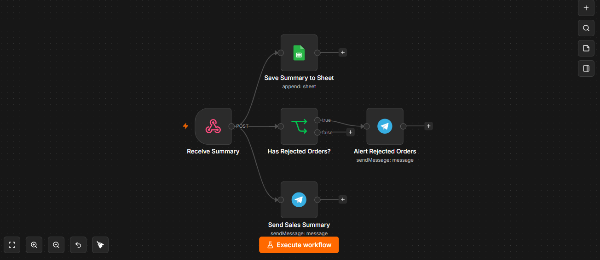

# Daily Sales Report (n8n)

An n8n workflow that runs every day, reads orders and prices from Google Sheets, merges them into one report, and sends it to Telegram.

## What it does

- Runs automatically on a daily schedule.
- Reads the orders sheet and the prices sheet from Google Sheets.
- Merges both into a single dataset.
- Sends the report to the store owner on Telegram.

## How it works

1. `Daily Schedule` starts the workflow every day.
2. `Get Orders` reads the orders from Google Sheets.
3. `Get Prices` reads the product prices from Google Sheets.
4. `Merge Data` combines orders and prices.
5. `Send Daily Report` sends the result to Telegram.

## Files

| File | Purpose |
|---|---|
| `daily-sales-report.json` | The n8n workflow (import it into n8n) |
| `workflow-screenshot.png` | Workflow overview |

## Setup

1. In n8n, import `daily-sales-report.json` (workflow menu, then Import from File).
2. Create the credentials. Credentials do not travel inside the JSON file.
   - Telegram: add your bot token from [@BotFather](https://t.me/BotFather).
   - Google Sheets: connect your Google account with OAuth.
3. Prepare two tabs in Google Sheets: one for orders and one for prices. Product names must match exactly between them, including capitalization.
4. In `Get Orders` and `Get Prices`, select your spreadsheet and tabs.
5. In `Send Daily Report`, set your own Telegram chat ID.
6. Set the time in `Daily Schedule` and the workflow timezone in the workflow settings.
7. Publish the workflow.

## Tech used

n8n, Schedule Trigger, Google Sheets API, Telegram Bot API.

## Notes

- The Merge node matches values exactly. A small difference in spelling or capitalization prevents the match.
